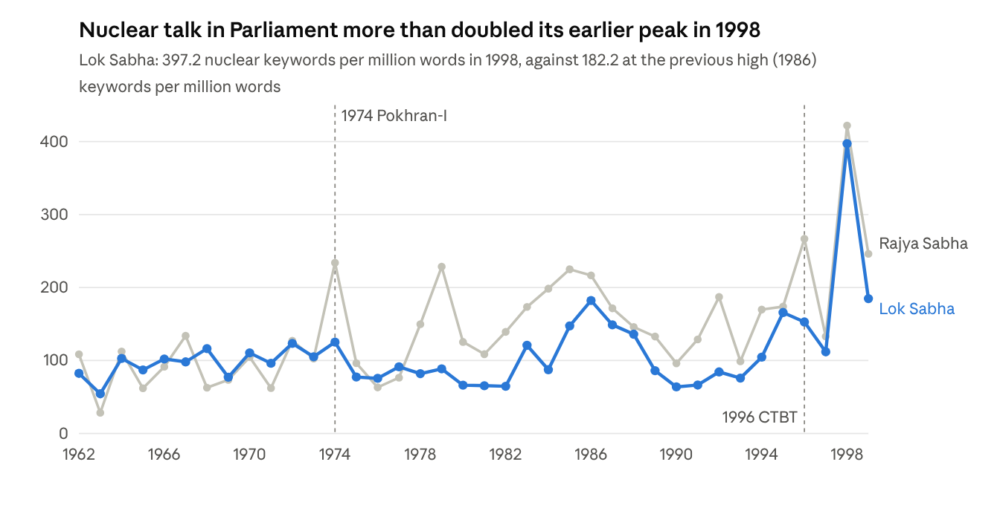
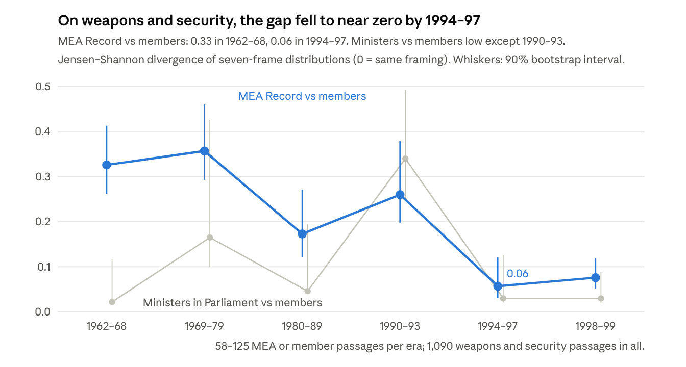
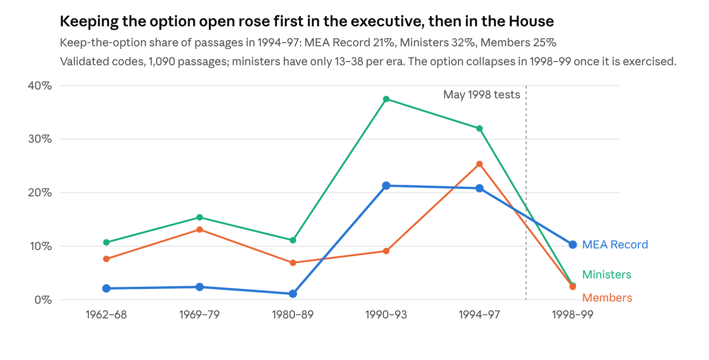
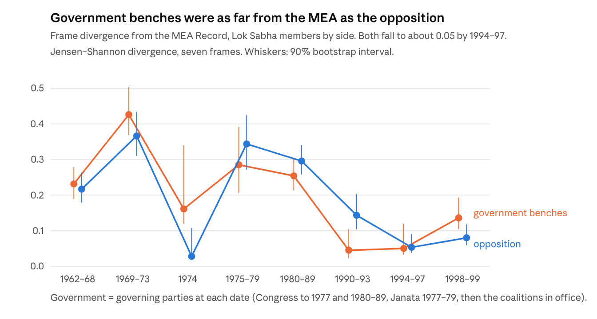
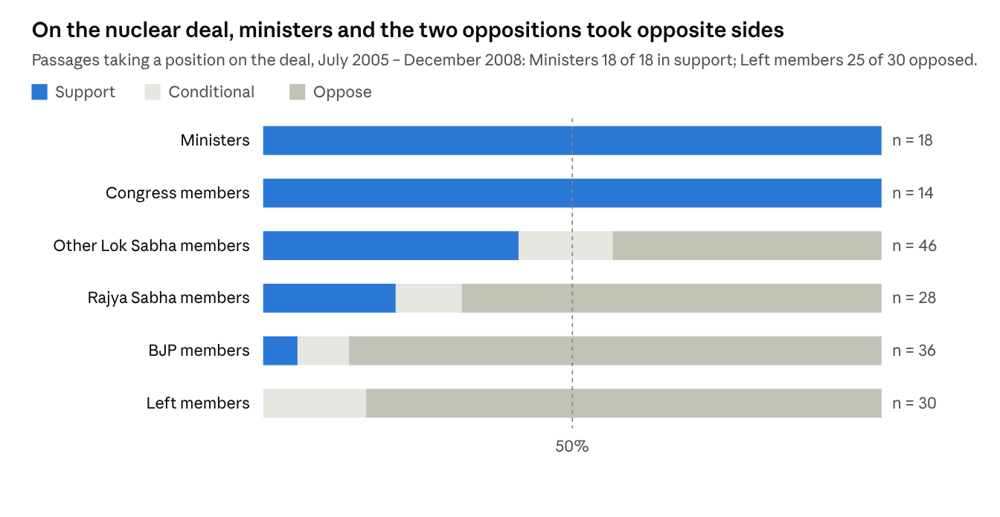

# Closing the Gap: Executive Secrecy, Parliamentary Debate and the Convergence of India's Nuclear Position, 1962–2008

Ravi · 26 October 2026 · Exported from the Claude Docs version: https://claude.ai/artifact/AKHUDzsPAWhy6abQpzCkfe

**Abstract.** India's nuclear decisions were made in secret by a small executive circle. This paper asks how far apart the executive and the legislature were, and whether that gap changed between 1962 and 1999. It uses a new full-text corpus of every Lok Sabha and Rajya Sabha sitting and the MEA's *Foreign Affairs Record*, from which 30,403 nuclear passages for 1962–99 are extracted. A stratified sample of 2,954 passages is coded for seven frames and seven stances by two independent language-model coders, with every disagreement adjudicated (Krippendorff's alpha 0.94 for relevance, 0.88 for stance). The analysis keeps the 1,090 passages about nuclear weapons and security. Inside Parliament, ministers and members framed the issue alike in most eras. The real gap lay between the executive's diplomatic voice and the House: about 0.35 in 1962–79, falling to 0.06 by 1994–97. The executive moved more than the legislature, as the MEA's emphasis shifted from disarmament to security and autonomy. What the two converged on was keeping the option open, which rose in the executive from 1990 and reached members in 1994–97. The 1998 tests did not complete the convergence: the executive's voice became pro-bomb, while members split almost evenly between supporting and criticising the tests. An extension to 2008 shows that once the option had been used, the Indo-US nuclear deal reopened the gap in position though not in framing: ministers supported it, and the Left and the BJP opposed it for different reasons.

## 1. Introduction

India's nuclear decisions were taken in secret, but they were not taken in a vacuum. The 1974 Pokhran explosion was known in advance to a handful of scientists and officials. So were the May 1998 tests. Parliament was told after the fact. This is the basis of a common objection: if the legislature did not decide, why study what it said?

This paper answers that objection by changing the question. It does not ask whether Parliament decided nuclear policy. It asks **how far apart the secret executive and the public legislature were, and whether that distance shrank or grew between the early 1960s and 1998.** Call this the *executive–legislative gap*. The gap has two parts:

- **A gap of content:** did ministers and members of Parliament argue about the bomb in the same terms, such as disarmament, peaceful use, discrimination, deterrence or keeping the option open?
- **A gap of position:** did the legislature want something the executive was not doing (a bomb in 1964–68, signing a treaty, or testing), or did it endorse what the executive was already doing in secret?

The paper argues that the gap **narrowed**, but only partly. By the mid-1990s the executive's diplomatic voice and the legislature framed the issue in similar terms and shared one position: India would sign neither the NPT nor the CTBT, and would keep the nuclear option open. That consensus did not decide the timing of Pokhran-II, and it did not survive it intact. Once the option was exercised, the House divided over the decision. A decade later the Indo-US nuclear deal divided it again, this time over what India might give up for civil cooperation.

The evidence is a new full-text corpus: every Lok Sabha and Rajya Sabha sitting from 1962 to 2008 and the Ministry of External Affairs' *Foreign Affairs Record* for 1962–99. Speech turns are tagged by speaker role (minister or member) and, in the Lok Sabha, by party. A stratified sample of 2,954 nuclear passages for 1962–99, balanced across voices and six eras, and a second sample of 1,493 passages for 2000–08 are coded blind by two independent language-model coders and adjudicated. That makes the gap measurable on validated codes rather than shown through selected quotations.

Section 2 sets out what the literature leaves open. Section 3 states the argument and six hypotheses. Section 4 describes the data and the coding. Section 5 reports the findings, from the 1960s to the nuclear deal. Section 6 reads three moments in the record closely, and section 7 discusses the results and their limits. Section 8 concludes.

## 2. The literature and the gap it leaves

The main accounts of India's nuclear path agree that a small executive circle took the key decisions. Abraham (1998) calls this circle the "strategic enclave": the Prime Minister, a few advisers and the atomic energy establishment, working with little oversight. Perkovich's (1999) detailed history, Chengappa's (2000) insider narrative and Kampani's (2014) work on why weaponisation took so long all rest on the same picture of a closed decision process. Kapur (1976) first described the "option" as a deliberate posture of the decision-makers. Kennedy (2011) and Sarkar (2022) place it in India's search for great-power guarantees and in Cold War nuclear diplomacy. Ganguly (1999) and Karnad (2002) explain the 1998 decision by security threats and strategic thinking.

These works use Parliament in three limited ways:

1. **As illustration.** A famous speech is quoted, such as Vajpayee or Jana Sangh members demanding a bomb after China's 1964 test, to show that "pressure" existed.
2. **As background noise.** Debates are treated as posturing that the enclave could ignore.
3. **As a source of official statements.** A Prime Minister's statement to the House is quoted for what it says about policy, not for how members responded to it.

Theoretical work points the same way. Sagan's (1996/97) "domestic politics" model and Hymans's (2006) account of leaders' national identity both locate the decision in a few actors' interests or beliefs. Neither offers a way to measure how far those actors were from the wider political class. Work on the 2005–08 nuclear deal (Mohan 2006; Tellis 2006) likewise reads the deal through the negotiators, and treats the parliamentary fight of 2008 as an obstacle rather than as evidence.

A separate literature makes such measurement possible. Text-as-data methods turn large political corpora into comparable measures (Grimmer and Stewart 2013), and recent work shows that language models can code political text with reliability close to, or above, that of trained human coders (Gilardi, Alizadeh and Kubli 2023). This paper applies those tools to a question that has so far been argued from quotation.

This leaves three gaps that this paper can fill:

- **No systematic measure.** No study has read every nuclear-related exchange in both Houses across decades. Claims such as "Parliament pressed for the bomb after 1964" or "there was a national consensus by the 1990s" are asserted, not counted.
- **No comparison of voices.** The literature does not separate what ministers said in Parliament, what members said, and what the government said abroad through the MEA. The gap between them is the object of this paper.
- **No account of how the consensus was built.** The 1998 decision is usually explained by the BJP's ideology or by the CTBT's entry-into-force clause. Both explain timing. Neither explains why the Congress, the Left and the regional parties all opposed signing the CTBT in 1996, or why the 1998 debate turned on *whether to exercise* an option everyone agreed to keep, not on whether India should have one.

The last point is the one parliamentary records can answer best.

## 3. Argument and hypotheses

The argument is that the executive–legislative gap narrowed from the 1960s to the late 1990s, and that it narrowed around one shared idea. The idea had three parts:

- **Discrimination:** the NPT and later the CTBT divided the world into nuclear "haves" and "have-nots". By 1998 this was called "nuclear apartheid".
- **Refusal:** India would not sign treaties built on that division.
- **Option:** India would "keep the option open" and neither give up nor openly use its capability.

The secret executive and the public legislature started from different places. In the 1960s the executive, above all in its diplomacy, spoke the language of disarmament and peaceful use. Many members, especially after China's 1964 test, spoke of threat and the bomb. The "option" formula was the bridge between them. It let the executive refuse both a bomb and a treaty, and let members hear a promise of a bomb when needed. Over three decades both sides took up the bridge as their own.

This yields six testable hypotheses:

|  | Hypothesis | What we should observe |
| --- | --- | --- |
| H1 | **Divergence in the 1960s.** Ministers and members used different frames after 1964. | Members' nuclear talk weighted toward threat and weapons; ministers' toward disarmament and peaceful use. A large frame distance in 1964–68. |
| H2 | **1974 is a closed-door fait accompli.** The PNE was presented in the executive's terms and debate then fell away. | A peak in salience in 1974, then a sharp drop in 1975–77, with ministers repeating "peaceful" and members not contesting the frame. |
| H3 | **The discrimination frame grows in both voices.** | The share of discrimination language rises over time in ministers' speech, members' speech and the MEA Record. |
| H4 | **Convergence by the 1990s.** | Frame distance between ministers and members is lower in 1994–99 than in 1964–68. "Option open" and "discriminatory" appear in both voices in the same years. |
| H5 | **The 1998 debate is about exercising, not having, the option.** | In 1998 members argue over timing and need for the tests, while accepting the option and the refusal to sign; "consensus" language peaks. |
| H6 | Once the option is used, the deal reopens the gap (2005–08). | Ministers support the Indo-US deal; the Left and the BJP oppose it, for different reasons (sovereignty and alignment for the Left, the weapons programme and testing for the BJP). |

A useful test of direction is **lead and lag**. If a phrase like "discriminatory treaty" or "keep the option open" appears first in members' speeches and only later in ministers' speeches or the MEA Record, the legislature helped shape the executive's language. If it appears first with ministers, the executive led and the House followed. Both outcomes are findings; the existing literature cannot tell them apart.

## 4. Data and method

The analysis covers 1962–2008 and draws on three full-text collections assembled for this project.

| Source | Voice it represents | Coverage used | Unit of analysis |
| --- | --- | --- | --- |
| Lok Sabha debates | Ministers and members (lower house) | Every sitting, 1962–2008 | Speech turn |
| Rajya Sabha debates | Ministers and members (upper house) | Every sitting, 1962–2008 | Speech turn |
| MEA *Foreign Affairs Record* | The executive speaking abroad and on the record | 1962–99, yearly | 400-word chunk |

**Speech turns and speaker roles.** Each sitting is split into turns at the printed speaker labels. A label like "THE MINISTER OF EXTERNAL AFFAIRS (SHRI SWARAN SINGH):" marks a minister. That minister's later turns under a plain name ("SHRI SWARAN SINGH:") are also coded as ministerial, but only within the government in which the person last spoke under a minister's label. After a change of government, an ex-minister's turns are members' turns. A sentence ending in "…Minister" that runs into a member's label ("SHRI SUSHIL KUMAR SHINDE (Solapur):") is read as the member's label. Both rules were added after the human check found opposition speeches from 1998 coded as ministerial. All other labelled speakers are members. The Speaker and Chairman are dropped.

**Nuclear passages.** A turn is nuclear-relevant if it contains a nuclear keyword (nuclear, atomic, NPT, CTBT, non-proliferation, test ban, Pokhran, plutonium, fissile, or the Hindi परमाणु / आणविक). Only the text within 60 words of a keyword is coded, so a long budget speech that mentions an atomic plant once does not swamp the counts.

**Frames.** Each passage can carry any of seven frames. The codebook defines each frame by the argument it makes, not by its words. For the measures that need the whole corpus, each frame also has a keyword dictionary:

1. **Disarmament:** disarmament, test ban, elimination of nuclear weapons, Six-Nation Initiative, Rajiv Gandhi's Action Plan.
2. **Peaceful use:** peaceful purposes, peaceful nuclear explosion, nuclear power stations.
3. **Option open:** keep the option open, nuclear option, foreclose, freedom of action.
4. **Discrimination:** discriminatory, apartheid, have-nots, unequal, hegemony, monopoly, club.
5. **Deterrence and weapons:** deterrent, weaponise, make the bomb, nuclear weapon state, no first use, arsenal.
6. **Security threat:** China, Pakistan, threat, national security, umbrella, guarantee.
7. **Autonomy:** sovereignty, national interest, pressure, sanctions, coercion, surrender.

"Consensus" is counted separately as a sign that speakers themselves saw the House as united.

**Stance.** Each relevant passage also takes one stance on India's own nuclear posture, applied in this order: *other country* (only about another state); *critical of tests* (criticises an Indian test, its timing or its consequences); *pro-bomb* (India should build, test or deploy, or the tests are justified); *keep the option* (keep the capability and refuse treaties that close it, without calling for a bomb now); *disarmament* (India should not build, or should seek global disarmament); *peaceful only* (defends the energy programme with no weapons position); and *neutral*. For 2000–08 a second variable records the passage's position on the Indo-US deal: support, oppose, conditional, neutral or none.

**Measuring the gap.** For each voice and era, the shares of the seven frames form a distribution. The gap is the **Jensen–Shannon divergence (JSD, base 2)** between two voices' distributions (Lin 1991). It runs from 0 (identical framing) to 1 (no overlap). Three pairs are compared: the MEA *Record* and members, ministers and members, and the MEA and ministers. The same measure over the five positional stances (pro-bomb, keep the option, disarmament, critical of tests, peaceful only) gives the gap in position. On the validated codes, intervals are 90% bootstrap intervals from 1,000 resamples of passages; the dictionary series uses 300 resamples of speech turns.

**Lead and lag.** For each key phrase, the first year with at least two uses is recorded separately for members, ministers and the MEA.

**Party and side.** Lok Sabha speakers are matched to election winners (ECI results compiled by DataMeet, elections of 1962–2004), using the constituency printed in the speaker label and an order-independent name match. Each matched member is then coded *government*, *outside support* or *opposition* according to the parties in office on the sitting date. For 2004–08 the UPA parties are the government, with the Left, SP and BSP outside until the Left withdrew on 8 July 2008. Two unstable spells (July 1979 – January 1980 and November 1990 – June 1991) are left unclassified. 54% of Lok Sabha member turns are matched; among the 45 most active speakers, every matched party checked was correct. Rajya Sabha members are left out of the party analysis, because name-only matching gave wrong parties.

**Validated coding.** Keyword dictionaries proved too weak to carry the main measure. Against adjudicated codes their F1 scores range from 0.40 (deterrence and weapons) to 0.83 (disarmament). The headline results therefore use a stratified sample of 2,954 passages: about 125 per voice (Lok Sabha members, Rajya Sabha members, ministers, MEA) in each of six eras. Two independent instances of the Claude language model coded each passage blind (text only) with a fixed codebook. A third instance adjudicated the 624 passages with any disagreement, giving a written reason for each ruling and following earlier rulings as precedent. Agreement between the two coders (Krippendorff's alpha; Krippendorff 2004): 0.94 for relevance, 0.88 for stance and 0.62–0.96 for the frames, with option open (0.62) and discrimination (0.69) the weakest. Of the 2,954 passages, 1,990 touch any nuclear topic. The analysis keeps the 1,090 about nuclear weapons and security (codebook 1.1): a passage stays if its stance is pro-bomb, keep the option, disarmament or critical of the tests, or if it carries a disarmament, option, discrimination, deterrence or security frame. Nuclear energy, plants and uranium trade alone are out of scope. The broad series is kept in the replication files and tells the same story with a smaller fall. The author hand-coded two check samples blind (section 7, Limitations). Gaps are computed on frame and stance distributions with 1,000 bootstrap resamples. The 2000–08 sample is described in section 5.8. The dictionary series on all 30,403 passages for 1962–99 is kept as a robustness check and for measures that need full coverage (salience, phrase lead and lag, party sides).

**Reproducibility.** All code, codebooks, coder outputs, adjudication rulings and output tables are in the `analysis/nuclear_1962_1999/` folder of the Lok Sabha repository (Appendix A).

## 5. Findings

On validated codes, the gap between India's diplomatic voice and the House fell from about 0.35 in 1962–79 to 0.06 in 1994–97. The MEA moved from disarmament toward the House's security framing, and keeping the option open spread first through the executive, then to members. Inside Parliament, ministers and members were close in most eras. The 1998 tests did not complete the convergence: they split the House over using the option.

### 5.1 When Parliament talked about the bomb

*Figure 1. Lok Sabha and Rajya Sabha debates, 1962–99; nuclear keyword hits per million words of each year's full text.*

Nuclear talk is not a constant hum; it spikes around executive acts. The Rajya Sabha peaks in 1974, 1979 and 1985–86; what drove the later peaks still needs close reading. Both houses jump in 1995–96 with the NPT extension and the CTBT, before the tests. After 1974 the Lok Sabha falls by more than a third in 1975, the year the Emergency began.

### 5.2 Where the gap was, and how it closed

On validated codes, the frame gap between the MEA and members of Parliament was 0.33 in 1962–68 and 0.36 in 1969–79. It narrowed in the 1980s (0.17), widened again in 1990–93 (0.26), and fell to 0.06 in 1994–97, with an interval (0.03–0.12) clear of every earlier era. It stayed low in 1998–99 (0.08). Ministers and members stayed close except in 1990–93 (0.34), a cell that rests on only 16 ministerial passages.

*Figure 2. Validated codes: 2,954 coded passages, 1,090 of them about nuclear weapons and security; two language-model coders with adjudication; 1,000 bootstrap resamples.*

- **The MEA moved more than the House.** Disarmament fell from 64% of the MEA's frame uses in 1962–68 to 33% in 1994–97, while security rose from 7% to 24% and autonomy from 0% to 8%. Members' mix changed less: security stayed at 34–36%, while discrimination rose from 4% to 13%.
- **The executive's two voices drew together.** The MEA and ministers in Parliament diverged by 0.09–0.21 until 1993 and by 0.03 in 1994–97.

| Frame share of weapons and security passages (validated) | 1962–68 | 1980–89 | 1994–97 | 1998–99 |
| --- | --- | --- | --- | --- |
| Disarmament — MEA | 64% | 68% | 33% | 30% |
| Disarmament — members | 20% | 30% | 21% | 9% |
| Security threat — MEA | 7% | 12% | 24% | 19% |
| Security threat — members | 34% | 40% | 36% | 30% |
| Discrimination — MEA | 18% | 9% | 20% | 12% |
| Discrimination — members | 4% | 2% | 13% | 7% |
| Autonomy — MEA | 0% | 2% | 8% | 13% |
| Autonomy — members | 7% | 7% | 10% | 16% |
| Deterrence and weapons — MEA | 2% | 6% | 4% | 19% |
| Deterrence and weapons — members | 26% | 8% | 13% | 32% |

An earlier check on 550 passages, with 1990–97 as one era, suggested the gap closed only in 1998–99. With five times the passages and the 1990s split in two, the narrowing appears in 1994–97. Restricting the analysis to weapons and security sharpens it. On all nuclear passages, energy included, the gap fell from 0.29 in the 1980s to 0.14 in 1994–97; on weapons and security alone, from 0.18 to 0.06.

### 5.3 What converged: the option, then a split over its use

The shared position of the mid-1990s was the option itself. A keep-the-option stance was rare in every voice before 1990. It rose first in the executive, to about a third of ministers' passages and a fifth of the MEA's in both 1990–93 and 1994–97. It reached members in 1994–97 (25%).

*Figure 3. Validated codes: stance = keep the option, as a share of weapons and security passages per voice and era.*

The MEA's diplomacy moved from disarmament to the option. A disarmament stance fell from 86% of MEA passages in 1962–68 (82 of 95) to 40% in 1994–97 (29 of 72), while keep-the-option rose from 2% to 21%.

The 1998 tests then split the House. Positional stances in 1998–99:

| Voice, 1998–99 | Relevant passages | Pro-bomb | Keep option | Disarmament | Critical of tests |
| --- | --- | --- | --- | --- | --- |
| MEA Record | 68 | 32 (47%) | 7 | 17 | 0 |
| Ministers | 38 | 22 (58%) | 1 | 2 | 1 |
| Members | 125 | 36 (29%) | 3 | 8 | 41 (33%) |

The gap in positions did not close. The stance divergence between the MEA and members was 0.25 in 1962–68, 0.20 in 1994–97 and 0.31 in 1998–99. Convergence came in the terms of debate and in keeping the option, not in agreement about using it.

### 5.4 Who spoke the idea first

The shared idea of the 1990s was built from two sides. The **discrimination** language came from the executive. The **option** language came from the House.

| Phrase | Members, first year (total uses) | Ministers | MEA Record | Led by |
| --- | --- | --- | --- | --- |
| haves and have-nots | 1966 (29) | 1992 (22) | 1965 (11) | Executive (MEA) |
| discriminatory treaty | 1992 (24) | 1977 (39) | 1967 (20) | Executive (MEA) |
| peaceful nuclear explosion | 1971 (39) | 1970 (41) | 1967 (44) | Executive (MEA) |
| nuclear option | 1970 (168) | 1985 (24) | 1998 (10) | Members |
| keep the option open | 1972 (99) | 1973 (11) | 1998 (2) | Members |
| nuclear apartheid | 1996 (8) | 1998 (4) | — (1) | Members |
| national consensus | 1995 (70) | 1992 (38) | 1988 (19) | Executive |
| no first use, weaponisation | 1998 | 1998 | 1998 | Together |

"First year" is the first year with at least two uses by that voice.

Members used "nuclear option" 168 times; the MEA Record used it 10 times, all from 1998. The option was the legislature's word for a policy the executive practised without naming it abroad. "Nuclear apartheid" also began with members. The Gujral exchange in section 6 shows a minister adopting it from the opposition in the House.

### 5.5 Speakers began to describe a consensus

Members used the word "consensus" less than once per 100 nuclear turns before 1990. The rate rose to 2.6 in 1994–97, 11.0 in 1998 and 8.2 in 1999. Ministers rose from 0.6 (1985–89) to 4.0 (1994–97). By the late 1990s both sides of the House were describing their shared position *as* a national consensus, even when they disputed who had broken it.

### 5.6 Government benches and opposition

The gap was not partisan. Lok Sabha members on the government benches were as far from the MEA as the opposition was, and both converged in the 1990s.

These side estimates rest on the keyword dictionaries, because the validated sample holds too few Lok Sabha passages per side before 1998 (16–36). Read them as indicative. For 1998–99 the validated sample is clear: of the Lok Sabha passages taking a position, government benches gave 11 pro-bomb and 2 critical of the tests; the opposition gave 5 pro-bomb and 15 critical.

*Figure 4. Lok Sabha member turns with a matched party (5,575), 1962–99, against MEA Record chunks; 300 bootstrap resamples.*

- **Until 1989, both sides of the House were far from the diplomats.** In 1969–73 government backbenchers diverged from the MEA by 0.43 and the opposition by 0.37; in 1980–89, by 0.25 and 0.30. Congress backbenchers spoke the House's security language, not the MEA's disarmament language.
- **Both reach about 0.05 in 1994–97.** The convergence of the mid-1990s takes in the whole House.
- **After the tests the order flips.** In 1998–99 the BJP-led government benches are further from the MEA (0.14) than the opposition (0.08). Government members leaned on autonomy language, such as sanctions and pressure: 22% of their frame uses, against 16% for the opposition.

The "consensus" language also changes sides. In 1994–97 government benches used it more (3.5 per 100 nuclear turns, against 1.6 for the opposition). In 1998–99 the opposition used it more (9.3 against 4.9), to accuse the government of breaking the consensus. Rupchand Pal (CPI-M) said in December 1998 that India's nuclear policy "in the pre-Pokhran period, had been one where there was a national consensus."

**The option was a socialist idea before it was a national one.** The phrase "keep the option open" first appears on the opposition benches in 1972, two years before Pokhran-I, and on the government benches in 1974. Prof. Madhu Dandavate (PSP) told the House on 2 May 1972:

> "Let us keep the nuclear options open as a deterrent and then, depending upon the economic situation and the permissible finance, it will be our strategy to decide at which particular stage we would like to enter into nuclear-weapons manufacture."

| Lok Sabha members, uses per 100 nuclear turns | Turns | "keep the option open" | "nuclear option" | "weaponisation" | "consensus" |
| --- | --- | --- | --- | --- | --- |
| Socialist / Janata, 1962–73 | 344 | 1.5 | 1.7 | 0 | 0 |
| Congress, 1962–73 | 682 | 0 | 0 | 0 | 0.2 |
| Socialist / Janata, 1974–79 | 146 | 2.1 | 2.1 | 0 | 0 |
| Congress, 1974–79 | 282 | 0.4 | 0.7 | 0 | 0 |
| Congress, 1990–97 | 355 | 2.8 | 4.5 | 0 | 2.0 |
| BJP, 1990–97 | 349 | 0.3 | 1.4 | 0 | 2.0 |
| Left, 1990–97 | 130 | 0 | 1.5 | 0 | 3.1 |
| Congress, 1998–99 | 220 | 1.4 | 2.7 | 6.8 | 9.1 |
| BJP, 1998–99 | 89 | 0 | 0 | 0 | 1.1 |
| Left, 1998–99 | 69 | 1.4 | 17.4 | 18.8 | 11.6 |

Three patterns stand out. The socialist opposition carried the option vocabulary in the 1960s and 1970s. Congress took it up after 1974, and it peaked on the Congress benches in the 1990s. The Jana Sangh and BJP rarely used it: they argued for a bomb, not an option. After the tests, the Left became the main defender of the old option against its exercise. Small samples apply: the Jana Sangh sat inside the Janata Party in 1977–80, and the BJP held two seats in 1984–89.

### 5.7 Robustness: the dictionary series

The dictionary series, built on all 30,403 passages, points the same way as the validated series but exaggerates the change: its MEA–members gap falls from 0.37 (1969–73) to 0.06 (1994–97). It holds in both houses and without the security frame.

| Period | Main measure (7 frames) | Without security frame | Lok Sabha only | Rajya Sabha only |
| --- | --- | --- | --- | --- |
| 1962–68 | 0.20 | 0.09 | 0.23 | 0.15 |
| 1969–73 | 0.37 | 0.28 | 0.37 | 0.36 |
| 1974 | 0.03 | 0.02 | 0.03 | 0.04 |
| 1975–79 | 0.29 | 0.24 | 0.28 | 0.30 |
| 1980–89 | 0.26 | 0.23 | 0.26 | 0.26 |
| 1990–93 | 0.12 | 0.16 | 0.10 | 0.16 |
| 1994–97 | 0.06 | 0.11 | 0.06 | 0.06 |
| 1998–99 | 0.08 | 0.15 | 0.10 | 0.08 |

Dropping the security frame removes every mention of China, Pakistan and threat. The gap still halves, from 0.23–0.28 in 1969–89 to 0.11 in 1994–97. So the convergence is not just an effect of country names. The 1960s divergence, by contrast, is mostly about threat: without the security frame it is only 0.09.

### 5.8 After the option was used: the nuclear deal, 2000–08

Did the convergence survive once the option was exercised? The series was extended to 2008 with a second sample of 1,493 parliamentary passages, coded by the same method. Up to 80 passages were drawn per voice and period: ministers; Lok Sabha Left, BJP, Congress and other members; Rajya Sabha members. There are four periods: the NDA government to May 2004; the UPA to the Joint Statement of 18 July 2005; the deal years to the Left's withdrawal on 8 July 2008; and the rest of 2008. A new variable records each passage's stance on the deal. Agreement between the two coders was high (alpha 0.97 for relevance, 0.91 for stance, 0.96 for deal stance). After 1999 the executive voice is ministers in Parliament only, since the MEA *Record* in this corpus stops in 1999.

*Figure 5. Validated codes (codebook 1.2): 2000–08 sample of 1,493 parliamentary passages, two language-model coders with adjudication; passages with a support, conditional or oppose deal stance, July 2005 – December 2008.*

The deal reopened the gap in position, not in vocabulary. Ministers and members still framed the nuclear question alike: the frame divergence was 0.04–0.07 until mid-2008, rising to 0.17 after the Left withdrew. On the deal itself they split. Every ministerial and Congress passage that took a position supported it. The Left and the BJP opposed it almost without exception, and the divergence in deal stance between ministers and members was 0.50 in 2005–08 and 0.60 in late 2008.

The two oppositions objected for different reasons. Half of the Left's frame uses were about autonomy (51%), and none about security threats: the case was sovereignty and alignment with the United States. The BJP also spoke of autonomy (33%), but added security (25%), the option (11%) and deterrence (8%). Its keep-the-option passages defended the right to test. Ministers, by contrast, framed the deal as energy (52% peaceful use). The consensus of the 1990s had been about keeping the option. Once the option had been used, the deal turned on what India might give up to gain civil cooperation, and the House divided again.

Ministerial cells are small in this period (9–23 relevant passages), because most ministerial nuclear talk was about plants and energy. The frame divergences therefore carry wide intervals; the deal-stance split does not depend on them.

## 6. Three moments in the record

The counts show the shape of the gap. The record itself shows how it closed. Three periods illustrate it. Speaker attributions below are as printed in the debates.

### 6.1 1962–68: a disarming executive and an anxious House

After the 1962 war and China's 1964 test, members' nuclear talk leaned on threat and weapons: security and deterrence made up 34% and 26% of their frame uses in 1962–68, and 18% of their passages called for a bomb. Ministers in the House spoke much the same language (security 33%, deterrence 18%), with more disarmament (31%). The MEA, speaking at Geneva and the UN, put disarmament first: 64% of its frame uses, and a disarmament stance in 86% of its passages. The gap in this decade lay between the government's language abroad and the language of the House.

The phrase "haves and have-nots" first appears in the MEA Record in 1965 and among members in 1966. This was the NPT negotiating period. The discrimination frame entered Parliament through the executive's own diplomacy.

### 6.2 1974: the gap closes, briefly, on the executive's terms

On the dictionary measures, 1974 is the one period when the MEA and the House almost agree (divergence 0.03); the validated sample is too coarse to isolate the year. The reason is that both adopted the executive's frame. "Peaceful use" rose to 31–32% of frame uses for the MEA and ministers and 24% for members. Opposition members defended the explosion in the government's language. Prof. Madhu Dandavate (8 August 1974) asked why, if other countries could use peaceful nuclear explosions, "India should be denied of the same under its own conditions."

The convergence did not last. Lok Sabha nuclear talk fell 38% in 1975, and the MEA went back to disarmament. 1974 was a fait accompli, accepted, not a shared idea.

### 6.3 1995–98: the shared idea, and the fight over who owns it

By the mid-1990s the House was framing the issue as a consensus to be defended. In May 1995 Mani Shankar Aiyar (Congress) accused the BJP of wrecking "the national consensus that existed until a few months ago on our keeping the nuclear weapons option open but not becoming a nuclear weapons power."

The CTBT debate of 1996 shows the executive taking the legislature's words. On 31 July 1996 Prakash Mani Tripathi (BJP) told the Lok Sabha that "the CTBT is an effort in nuclear apartheid." Two days later the External Affairs Minister, I. K. Gujral of the United Front government, replied:

> "I have seen the statement about nuclear apartheid and I share his views. Therefore, the Government's policy on CTBT reflects what Shri Atal Bihari Vajpayee has said."

This is the convergence in a single sentence: a minister stating that government policy reflects the opposition leader's framing.

After the May 1998 tests the opposition did not dispute the option or the refusal to sign. It disputed the *use* of the option. K. Natwar Singh (Congress) told the House on 27 May 1998:

> "There was a national consensus on keeping the nuclear option open. There was no consensus on your exercising that option."

This is H5 in the members' own words. The debate after Pokhran-II was about exercising an agreed option, not about whether India should have one.

## 7. Discussion, limitations and next steps

The central claim holds in revised form. By the mid-1990s the executive and the legislature had converged on how to frame the issue and on keeping the option open. The gap that closed was between the executive's voice abroad and the House at home, not between ministers and members. And the convergence stopped at the decision to test.

| Hypothesis | Verdict (validated codes) | Evidence |
| --- | --- | --- |
| H1 Divergence in the 1960s | Supported for the MEA, not for ministers | MEA–members gap 0.33 (0.26–0.41), ministers–members only 0.02; 18% of members' passages pro-bomb in 1962–68, none of the MEA's |
| H2 1974 as fait accompli | Not testable on validated codes | The 1969–79 era is too broad; dictionary and qualitative evidence only (section 6.2) |
| H3 Discrimination frame grows | Supported for members only | MEA 18% to 20% of frame uses (1962–68 to 1994–97); members 4% to 13% |
| H4 Convergence by the 1990s | Supported for framing and for the option | Gap 0.33 (1962–68) and 0.17 (1980s) to 0.06 (1994–97); keep-the-option rises in the executive from 1990 and in members in 1994–97 |
| H5 1998 about exercising, not having, the option | Supported | Members in 1998–99: 36 pro-bomb and 41 critical passages; only 3 still argue to keep the option unexercised |
| H6 The deal reopens the gap | Supported on position, not on framing | Deal-stance divergence, ministers vs members, 0.50 (2005–08) and 0.60 (late 2008); frame divergence 0.04–0.07, then 0.17; Left 51% autonomy frames, BJP adds security, option and deterrence |

The party data suggest the convergence was national rather than partisan, but they rest on the dictionaries and the validated sample is too small to test this before 1998. In 1998–99 the split followed party lines: government benches defended the tests and the opposition criticised them.

**What this adds to the literature.** The strategic-enclave account explains who decided and when. It does not explain why the decision met so little resistance. The record suggests the answer: the executive's outward language moved toward the framing the House had used for decades. The "option" vocabulary was the legislature's, and ministers took up "nuclear apartheid" from the opposition. Pokhran-II was secret in timing but not in substance. It exercised an idea the House had built and the executive had come to share.

The finding also suggests a "two voices" model of the executive. Ministers in Parliament spoke in members' terms. Diplomats at Geneva spoke of disarmament. The two voices were never far apart on weapons questions (0.09–0.21), but they became one in 1994–97 (0.03), the same years the MEA's distance from the House fell to 0.06.

The deal years show what kind of consensus it was. It was a consensus on keeping a choice open, not on any particular use of it. When the executive used the option in 1998, the House split over the decision. When it traded part of the programme's freedom for civil cooperation in 2005–08, the House split again, and the two oppositions came at the deal from opposite directions: the Left from sovereignty and non-alignment, the BJP from the weapons programme and the right to test. In both moments the executive and the House kept a shared vocabulary while disagreeing on the act. The gap that matters for policy, then, is a gap of position, and the parliamentary record shows it reopening whenever the executive turned the shared idea into a decision.

**Limitations.**

- **Coding by language models, and the human check.** All 2,954 passages were coded by models. Two independent model coders agree well (alpha 0.88 for stance), but they may share blind spots, and the adjudicator is the same kind of model. The author coded two check samples blind. On 22 random passages, agreement on relevance was 82% under the weapons-and-security rule (55% under the broad rule, which counted nuclear energy). On 29 relevant passages chosen to cover every stance, the author and the model agreed on stance for only 5 of 21 both found relevant (24%; alpha 0.11). A review of each disagreement against the codebook (by Claude, which saw both codes, so it is not independent) found most differences came from the author marking short or Hindi passages as not relevant, coding attacks on the tests as "peaceful only", and marking more frames per passage (2.9 against 1.9). Human–model agreement on stance therefore remains unestablished, and a second human coder trained on the codebook is the most important next step.
- **Narrow scope applied after coding.** The weapons-and-security rule is applied to codes made under a broader codebook, so an energy passage that bears on weapons only implicitly may be lost. The broad series shows the same pattern with a smaller fall (0.29 to 0.14).
- **Weak dictionaries.** The keyword measures used for salience, phrase lead and lag, and party sides score F1 0.40–0.83 against the validated codes. They are reported as context, not as the main result.
- **Text quality.** The debates were converted from scanned pages; words are broken and misread, and speeches in Hindi are poorly captured.
- **Speaker roles.** Roles come from printed labels and can be wrong. The human check exposed two faults, now fixed (section 4); they moved 14 of 750 coded ministerial passages to members and changed no finding. Misread labels remain: I. K. Gujral's 1996 reply was coded as a member's turn.
- **Thin cells.** On weapons and security, ministers supply only 13–38 passages per era and the MEA 61–95. Only three government and opposition cells reach the minimum size on validated codes. In 2000–08 ministers supply 9–23 relevant passages per period, and the executive voice is ministers in Parliament only.
- **Public sources only.** None of this shows the secret deliberations. It measures the public side of the gap.

**Next steps.**

1. Extend party labels to the Rajya Sabha from the Secretariat's lists of members, and add Lok Sabha by-election winners and party switches such as the 1969 Congress split.
2. Have a second human coder, trained on the codebook with worked examples, code the same 30 passages, so that human–human agreement can be set beside human–model agreement.
3. Compare with archival evidence available online: the Wilson Center's Nuclear Proliferation International History Project, the US Foreign Relations of the United States volumes on South Asia, and digitised Indian files on Abhilekh Patal.
4. Add an executive voice outside Parliament for 2000–08 (MEA speeches and statements), so the deal years can be read on the same three-voice footing as 1962–99.

## 8. Conclusion

India's nuclear decisions were secret, but the ideas behind them were not. Measured across four decades of parliamentary debate and diplomatic record, the distance between the executive and the legislature was large in the 1960s and 1970s and small by the mid-1990s. It closed because the executive's diplomatic voice moved: away from disarmament and toward the security, autonomy and option language that the House had used since China's first test. Ministers in Parliament had spoken the House's language all along. The idea on which the two met, keeping the option open, was named first by members of the socialist opposition and became the government's position only later.

The convergence was real but limited. It covered the terms of debate and the refusal to close the option, not the decision to use it. Pokhran-II split the House over exercising an option it had agreed to keep, and the Indo-US deal split it again over what to give up. The strategic-enclave account explains who decided and when. This paper adds why those decisions met so little resistance in principle and so much in practice: the enclave acted within a consensus the legislature had helped to build, and each time it turned that consensus into an act, the consensus divided.

The method travels. Full-text parliamentary records, coded by language models with blind double coding and adjudication, can measure the distance between secret executives and public legislatures in other nuclear and security decisions, provided that, as here, the coding is checked by people and its limits are reported.

## References

Compiled from memory; check editions and page numbers before submission.

**Primary sources (this project's corpora)**

- Lok Sabha Secretariat. *Lok Sabha Debates*, 1962–1999. Full-text archive: `RaviRasputin/Parliamentary_Debates-Lok-Sabha-`.
- Rajya Sabha Secretariat. *Rajya Sabha Debates (Official Report)*, 1962–1999. Full-text archive: `RaviRasputin/Parliamentary_Debates-Rajya-Sabha-`.
- Ministry of External Affairs. *Foreign Affairs Record*, 1962–1999. Full-text archive: `RaviRasputin/Foreign_Affairs_Record-MEA-1955-1999`.

**Secondary literature**

- Abraham, Itty. 1998. *The Making of the Indian Atomic Bomb: Science, Secrecy and the Postcolonial State*. London: Zed Books.
- Chengappa, Raj. 2000. *Weapons of Peace: The Secret Story of India's Quest to Be a Nuclear Power*. New Delhi: HarperCollins.
- Ganguly, Sumit. 1999. "India's Pathway to Pokhran II: The Prospects and Sources of New Delhi's Nuclear Weapons Program." *International Security* 23(4).
- Gilardi, Fabrizio, Meysam Alizadeh and Maël Kubli. 2023. "ChatGPT Outperforms Crowd Workers for Text-Annotation Tasks." *Proceedings of the National Academy of Sciences* 120(30).
- Grimmer, Justin and Brandon M. Stewart. 2013. "Text as Data: The Promise and Pitfalls of Automatic Content Analysis Methods for Political Texts." *Political Analysis* 21(3).
- Hymans, Jacques E. C. 2006. *The Psychology of Nuclear Proliferation: Identity, Emotions and Foreign Policy*. Cambridge: Cambridge University Press.
- Kampani, Gaurav. 2014. "New Delhi's Long Nuclear Journey: How Secrecy and Institutional Roadblocks Delayed India's Weaponization." *International Security* 38(4).
- Kapur, Ashok. 1976. *India's Nuclear Option: Atomic Diplomacy and Decision Making*. New York: Praeger.
- Karnad, Bharat. 2002. *Nuclear Weapons and Indian Security: The Realist Foundations of Strategy*. New Delhi: Macmillan.
- Kennedy, Andrew B. 2011. "India's Nuclear Odyssey: Implicit Umbrellas, Diplomatic Disappointments, and the Bomb." *International Security* 36(2).
- Krippendorff, Klaus. 2004. *Content Analysis: An Introduction to Its Methodology*. 2nd ed. Thousand Oaks, CA: Sage.
- Lin, Jianhua. 1991. "Divergence Measures Based on the Shannon Entropy." *IEEE Transactions on Information Theory* 37(1).
- Mohan, C. Raja. 2006. *Impossible Allies: Nuclear India, United States and the Global Order*. New Delhi: India Research Press.
- Perkovich, George. 1999. *India's Nuclear Bomb: The Impact on Global Proliferation*. Berkeley: University of California Press.
- Sagan, Scott D. 1996/97. "Why Do States Build Nuclear Weapons? Three Models in Search of a Bomb." *International Security* 21(3).
- Sarkar, Jayita. 2022. *Ploughshares and Swords: India's Nuclear Program in the Global Cold War*. Ithaca: Cornell University Press.
- Singh, Jaswant. 1998. "Against Nuclear Apartheid." *Foreign Affairs* 77(5).
- Tellis, Ashley J. 2006. *Atoms for War? U.S.-Indian Civilian Nuclear Cooperation and India's Nuclear Arsenal*. Washington, DC: Carnegie Endowment for International Peace.

## Appendix A. Coding, validation and replication

| Item | 1962–99 | 2000–08 |
| --- | --- | --- |
| Nuclear passages in the corpus | 30,403 | 7,199 (parliament only) |
| Coded sample | 2,954 (about 125 per voice and era, plus 50 near-miss passages) | 1,493 (up to 80 per voice and period) |
| Relevant under the analysis rule | 1,090 (weapons and security) | 474 (weapons and security, or the deal) |
| Codebook | Version 1.0, scope narrowed by rule in 1.1 | Version 1.2 (adds deal stance) |
| Coders | Two blind Claude coders, isolated batches | Same |
| Passages adjudicated by Opus | 624 (955 rulings) | 200 (327 rulings) |
| Alpha: relevance / stance | 0.94 / 0.88 | 0.97 / 0.91 |
| Alpha: frames | 0.62–0.96 | 0.67–0.85 |
| Alpha: deal stance | — | 0.96 |
| Human check (author) | 22 random passages: relevance 82%; 29 relevant passages: stance 24% | — |

Dictionary F1 against the adjudicated codes ranges from 0.40 (deterrence and weapons) to 0.83 (disarmament).

**Replication files** (`analysis/nuclear_1962_1999/`):

- `extract.py`: splits sittings into speech turns, assigns roles and writes the nuclear passages.
- `party.py`, `party_analysis.py`: Lok Sabha party and side labels, and the dictionary-based side measures.
- `sample.py`, `sample2.py`, `sample3.py`: draw the coding samples.
- `validate.py`, `e3.py`: merge the coders' codes, measure agreement and build the gold codes.
- `revoice.py`, `validated_series.py`: correct voices and build the validated series.
- `human_check.py`: compares the author's codes with the model codes.
- `validation/`: `CODEBOOK.md`, the coder files, adjudication rulings with reasons, gold codes, all series and `REPORT.md`.
